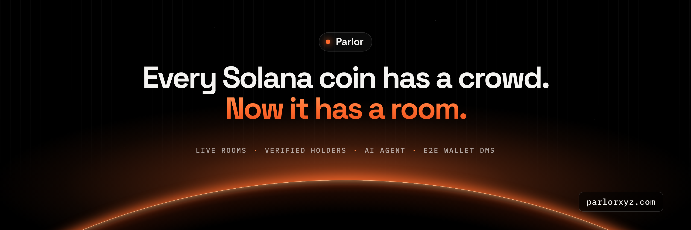
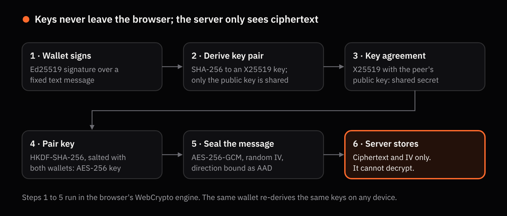

<p align="center">
  
</p>

<p align="center">
  <a href="https://parlorxyz.com"><b>parlorxyz.com</b></a> ·
  <a href="https://parlorxyz.com/docs">Docs</a> ·
  <a href="https://x.com/Parlorxyz">X</a> ·
  <a href="docs/ENCRYPTION.md">Encryption spec</a> ·
  <a href="SECURITY.md">Security</a>
</p>

<p align="center">
  <a href="https://github.com/parlorxyz/parlor/actions/workflows/test.yml"></a>
</p>

# Parlor

**The accountability layer for on-chain markets.** Parlor gives every Solana token one live room, keyed by its contract address, and binds every verified message to the sender's on-chain position. Around that room it puts the chart, live trades, the top 100 holders, an AI analyst and end-to-end encrypted wallet-to-wallet messaging.

On-chain markets made capital transparent. They never made conversation accountable. Parlor does.

## What's in a room

| | |
| --- | --- |
| **One room per token** | Generated the moment anyone searches a ticker or contract address. Nobody owns it, so nobody can censor it. |
| **Holder-verified chat** | Wallets sign in with a plain-text signature. Each message is stamped with the sender's balance at the moment it was sent: 🐋 1%+, 🐬 0.1%+, 🐟 any, or *no bag*. |
| **Top 100 holders** | Read from the chain, with pools and bonding curves labelled and 2,200+ known wallets tagged. |
| **The Agent** | An AI analyst grounded in the room's live data. Ask "red flags?" or "who's buying?", and it posts when whales move, liquidity is pulled or the price swings. |
| **Encrypted DMs to any wallet** | X25519 + HKDF-SHA-256 + AES-256-GCM, keys derived from your wallet signature. Write to any address, even one that has never used Parlor. |
| **Scam-link shield** | Drainers, link shorteners, raw IPs and look-alike domains are blocked before a message is stored. |

## This repository

Parlor's documentation, security model and client-side cryptography, published so anyone can verify what the app does with their wallet and their messages.

```
client/
  e2e.js            The encryption module the web app runs in your browser
  e2e.test.mjs      Tests: key determinism, key agreement, replay and tamper resistance
docs/
  ENCRYPTION.md     Full messaging protocol and threat model
  ARCHITECTURE.md   How rooms, data, verification and the Agent fit together
  VERIFICATION.md   Wallet sign-in, holder badges and .sol resolution
  AGENT.md          The Agent's context, alerts and the 0–100 risk score
SECURITY.md         How to report a vulnerability
```

### Run the tests

Requires Node.js 20 or newer. No dependencies.

```bash
git clone https://github.com/parlorxyz/parlor.git
cd parlor
npm test
```

## Encryption in one picture

<p align="center"></p>

1. Your wallet signs a fixed text message. Ed25519 signatures are deterministic, so the same wallet always produces the same signature.
2. The signature is hashed with SHA-256 into an X25519 private key, created non-extractable in WebCrypto. Only the public key is published.
3. Your private key and the other wallet's public key meet in an X25519 exchange.
4. HKDF-SHA-256, salted with both addresses, turns the shared secret into one AES-256 key per pair of wallets.
5. Each message is sealed with AES-256-GCM under a fresh random IV, with the direction bound as authenticated data.

The server stores ciphertext only. Read the full protocol in [docs/ENCRYPTION.md](docs/ENCRYPTION.md).

## Wallets

Wallet connection runs through [Privy](https://privy.io), with Phantom, Solflare, Backpack and other Solana wallets. Parlor only ever asks for a plain-text signature, never a transaction, so connecting can never move funds.

## Stack

Node.js 22 · SQLite (`node:sqlite`) · Server-Sent Events · vanilla JavaScript · WebCrypto · Privy · Helius RPC · DexScreener · GeckoTerminal · Solana Name Service · Google Gemini

## $PARLOR

$PARLOR is the token behind the platform. The only official contract address is the one shown at [parlorxyz.com](https://parlorxyz.com) and posted by [@Parlorxyz](https://x.com/Parlorxyz). Anything else is fake.

*Parlor shows public market data and what people say. Nothing here is financial advice.*
